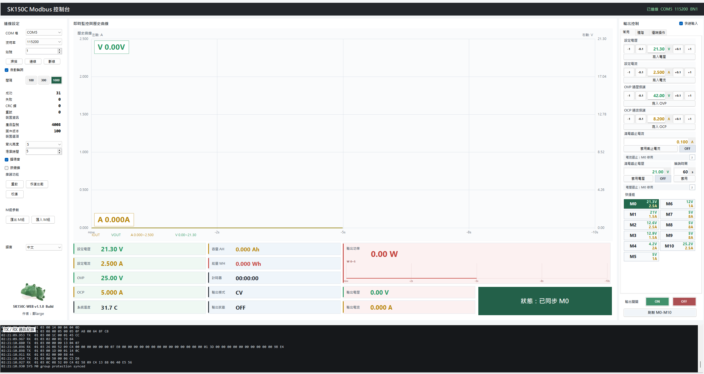
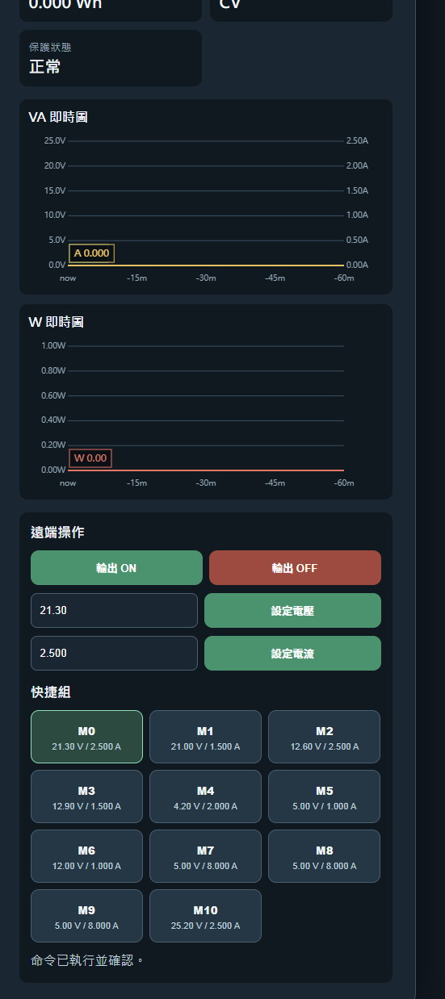
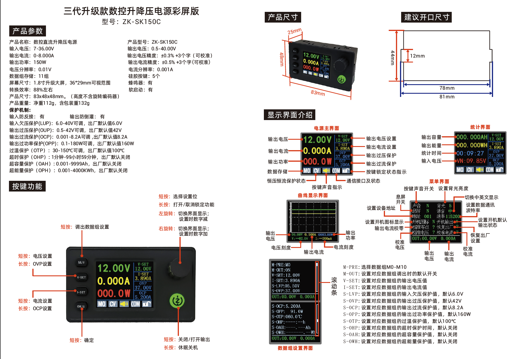

# SK150C WEB 遠端控制版

SK150C Windows Modbus 控制台，支援 ZK-SK150C 電源控制、M0–M10 快捷組、即時曲線、充電截止設定，以及透過手機 WEB 遠端操作。

> 本倉庫是唯一正式公開下載來源，請勿從不明網站取得舊版或修改版程式。

## 快速入口

| 功能 | 入口 |
|---|---|
| Windows 最新版 | **[下載 SK150C v1.2.0](https://github.com/ifoundu-tw/SK150C-Control/releases/latest)** |
| 手機 WEB 遠端控制 | **[開啟 https://sk150c-remote.web.app](https://sk150c-remote.web.app)** |
| 版本政策 | [`version-policy.json`](version-policy.json) |

目前正式版本：`v1.2.0`。舊版已停止公開與支援。

## Windows 安裝

1. 從 [Latest Release](https://github.com/ifoundu-tw/SK150C-Control/releases/latest) 下載 `SK150C-WEB-v1.2.0.zip`。
2. 將 ZIP 完整解壓縮到一個可寫入的資料夾，不要直接在 ZIP 內執行。
3. 保持下列兩個檔案在同一資料夾：

   ```text
   SK150C-Control.exe
   SK150C.Updater.exe
   ```

4. 執行 `SK150C-Control.exe`。

`SK150C.Updater.exe` 是自動更新必要元件，請勿刪除或單獨移動。

## 電腦端基本操作

1. 使用 USB 轉 TTL/UART 連接 ZK-SK150C，再開啟程式。
2. 於左側「連線設定」選擇 COM 埠。
3. 一般通訊設定為 `115200` baud、`8N1`、站號 `1`；若設備已改過參數，請以設備實際設定為準。
4. 按「掃描」更新 COM 清單，再按「連線」。
5. 連線後可設定電壓、電流、OVP/OCP、充電截止條件與 M0–M10 快捷組。
6. 確認電源、負載與保護參數後，才使用右下角 `ON` / `OFF` 控制輸出。



## 手機 WEB 遠端控制

WEB 入口：**[https://sk150c-remote.web.app](https://sk150c-remote.web.app)**

### 首次配對

1. 電腦端先完成 COM 連線。
2. 在電腦端開啟「遠端服務」。遠端服務每次啟動程式時預設為關閉，必須手動開啟。
3. 按「產生配對連結」，以手機掃描 QR Code，或複製連結至手機開啟。
4. 配對連結有效期為 5 分鐘，請在期限內以 Google 帳號登入。
5. 手機按「向電腦提出配對」。
6. 核對手機與電腦顯示的確認碼，再回到電腦端按「允許」。
7. 配對完成後，手機可查看即時狀態、VA/W 曲線、設定電壓與電流、切換 M0–M10 及控制輸出。

每台電腦只允許一個 Google 管理者；若要更換管理者，必須從電腦端解除配對後重新進行。



## 設備面板與參數參考

下圖為 ZK-SK150C 裝置尺寸、螢幕資訊、按鍵操作與保護參數參考。實際規格與線路連接請以手邊設備版本及原廠說明為準。



## 自動更新

`v1.1.0` 是第一個支援 GitHub 自動更新的基礎版本。

- 程式啟動後會在背景檢查正式最新版本。
- 新版套件下載完成後會驗證 SHA-256。
- 當設備輸出為 ON 或仍有 Modbus 指令執行時，安裝會延後。
- 更新時由 `SK150C.Updater.exe` 備份舊檔、替換新版並重新啟動。

更新政策以 [`version-policy.json`](version-policy.json) 為準。

## 安全提醒

- 手機遠端控制不是緊急停止系統。
- Firebase、網路、COM 或電腦斷線時，程式不會擅自改變 SK150C 當前輸出狀態。
- 手機「輸出 ON」需要再次確認；「輸出 OFF」會立即送出。
- 操作前請確認 OVP、OCP、線材、散熱、負載與輸入電源容量。
- 請勿將公開網路遠端控制當作無人值守的唯一保護機制。

## 常見問題

### 手機顯示設備離線

確認 Windows 程式仍在執行、COM 已連線，且本次程式啟動後已手動開啟遠端服務。

### 無法配對

配對憑證只有 5 分鐘效期且僅能使用一次。請從電腦端重新產生連結，並確認電腦上的確認碼。

### 無法自動更新

確認 `SK150C-Control.exe` 與 `SK150C.Updater.exe` 在同一資料夾，且該資料夾可寫入。若設備正在輸出，請先安全關閉輸出後再安裝。

## 支援範圍

- Windows Forms 桌面程式
- ZK-SK150C Modbus RTU / COM 連線
- 手機瀏覽器與 Google 帳號
- 單一程式執行個體與單一 COM 連線

## 原始碼

本倉庫僅用於正式版本發布與自動更新，不提供原始碼。
